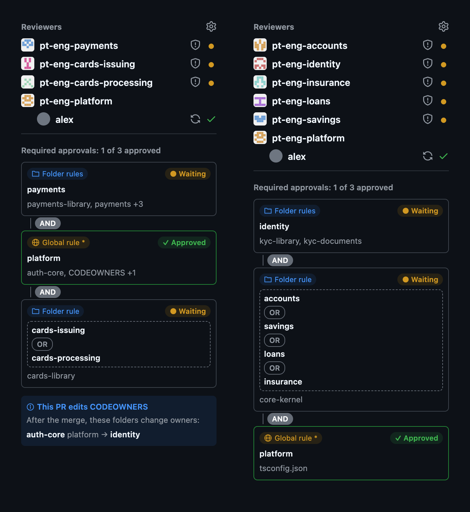

# GitHub PR - required approvals

Chrome extension that adds a "Required approvals" section under the "Reviewers" block of a pull request.
It shows which CODEOWNERS approvals are needed (AND / OR), whether each one comes from the global rule (`*`)
or from a folder rule, and which folders triggered it.



## Install

1. Download [github-required-approvals-extension.zip](github-required-approvals-extension.zip) and unzip it
   (or use this folder directly).
2. Open `chrome://extensions`.
3. Turn on "Developer mode" (top right).
4. Click "Load unpacked" and select the unzipped folder.
5. Open a pull request on github.com.

Each card shows its review state, read live from the Reviewers block (no request):
"Approved" when one of its owners approved, "Changes requested", or "Waiting".
When an owner is in several cards, the card says so: one approval from it counts for all of them.

## How it works

- No token: it reads github.com pages with your current session.
- Only permission: `storage`, for a local cache. Nothing leaves your browser.
- Cache: a result shows at once when you come back to a pull request. It is refreshed in the
  background after 2 minutes, and the CODEOWNERS file of a branch after 10 minutes.
  Entries older than 24 hours are dropped.
- Loading starts as soon as the page starts loading, before GitHub draws the page.
- Changed files: the "Files changed" page of the pull request (`diffSummaries` in the new view,
  the "Jump to file" list in the classic view).
- Rules: the CODEOWNERS file of the base branch, like GitHub. When the pull request edits
  CODEOWNERS, a note lists the folders whose owners change after the merge.
- Works on the classic and the new pull request views.

## Development

No build step: edit `content.js`, then click the reload button of the extension in `chrome://extensions`.

```sh
npm test            # pure logic, plain Node, no install needed
npm install         # once, for the end-to-end test
npm run test:e2e    # real extension in Chromium, with github.com simulated
npm run zip         # rebuild github-required-approvals-extension.zip
```

The end-to-end test uses Playwright's Chromium (`npx playwright-core install chromium`), or the
build given in `CHROMIUM_PATH`. See `ARCHITECTURE.md` before changing the code.
